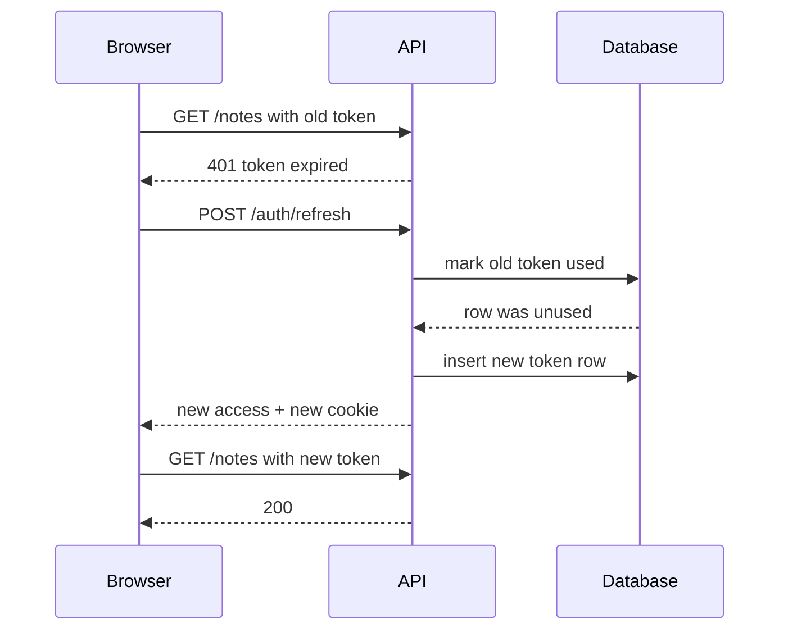
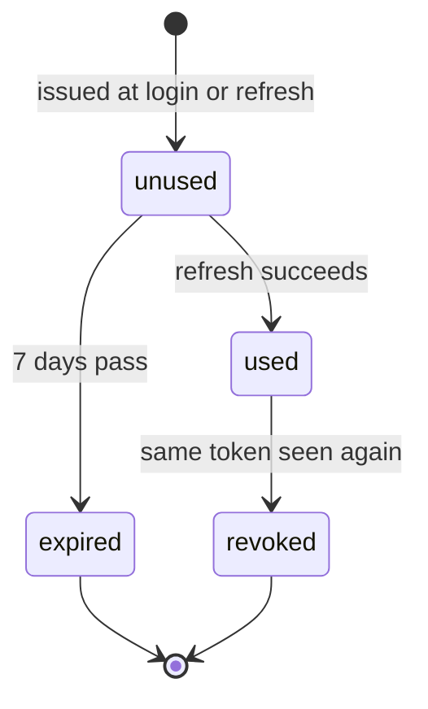

# Auth — Deep Dive

> **Track:** BE · **Type:** concept · **Scheduled:** Week 4 · **Runtime:** Node v22.14.0 (jsonwebtoken 9.0.3, bcrypt 6.0.0, express 5.3.0) · **Generated:** 2026-10-27

## Why It Exists

Asha types her email and password and the server says "correct". Her next click is `GET /notes`. This section is about why that second request is a problem.

Prerequisites: promises and closures — see your own notes on both; this doc uses `async/await` and a function that returns a function. You have no notes yet on HTTP, cookies, Express middleware or Postgres tables, so each gets a short primer where it is first needed.

**Primer — HTTP in six lines** *(no notes yet)*

- A client sends a **request**: a method and path (`GET /notes`), headers, sometimes a body.
- The server sends back a **response**: a status code, headers, sometimes a body.
- Headers are `Name: value` lines. `Authorization` and `Cookie` are the two that carry "who I am".
- Status codes used here: `200` ok, `401` "I don't know who you are", `403` "I know who you are, and no".
- Each request and its response stand alone; nothing links two requests together.
- `fetch` sends requests (browser and Node); Express receives them.

*(Idea 1)* Run this: a server that greets whoever the request names, and a client that makes two requests.

```js
const http = require("http");

const server = http.createServer((req, res) => {
  res.end(`hello, ${req.headers.authorization ?? "nobody"}`);
});

server.listen(0, async () => {
  const url = `http://127.0.0.1:${server.address().port}`;
  const first = await fetch(url, { headers: { Authorization: "asha" } });
  console.log(await first.text());
  const second = await fetch(url);
  console.log(await second.text());
  server.close();
});
```

```text
hello, asha
hello, nobody
```

The server only knew Asha in the first request because that request said so. The second request, a moment later, got `nobody`: the server kept no memory of the first. HTTP is **stateless**.

It is built that way on purpose. A server handling thousands of strangers would otherwise need a memory per client. Connections are closed and reused. With several servers behind a load balancer, the next request may land on a different machine.

So "logging in" cannot mean "the server now knows Asha". It has to mean: the server hands Asha something, and her client attaches it to every later request.

```text
login ok --> server hands out a "something" --> client attaches it to every request
                                                          |
                                      server turns it back into "this is Asha"
```

Everything below is a choice about what that something is, what the server does with it, and where the client keeps it.

## Level 1 — Intuition

The story is in [brief.md](brief.md) → Explain It Like I'm 5. Two theme parks solve the same problem differently.

**Park A: the ticket number** *(Idea 2)*. The front desk keeps your bag and gives you a numbered ticket. The number means nothing by itself; ride guards ask the desk what it means. The desk holds all the knowledge, so it can tear up ticket 17 in a second. That is a **session**: the server keeps the state, the client carries a meaningless ID.

**Park B: the wristband** *(Idea 3)*. The desk writes everything on the wristband ("Asha, adult, good until 6:00") and adds a sparkle nobody can copy. Guards need no phone call; they check the sparkle and the clock. That is a **token**: the client carries the state, signed so it cannot be edited.

**The catch, and the fix** *(Idea 8)*. In Park B nobody can cancel a wristband already on your wrist. So wristbands last only 15 minutes, and you keep a paper receipt. Show the receipt at the desk and you get a fresh wristband; the desk keeps a record, so it can say no. The wristband is the **access token**, the receipt is the **refresh token**.

```text
PARK A: ticket number (a session)

  guest --> "ticket 17" --> ride guard --> "is 17 ok?" --> front desk
  guest <-- "ride!" <------ ride guard <-- "yes, Asha" <-- front desk

PARK B: wristband (a token)

  guest --> "wristband: Asha, adult, until 6:00 + sparkle" --> ride guard
  guest <-- "ride!" <----------------------------------------- ride guard
            (the guard checks the sparkle and the clock; no phone call)
```

**Recap:** a session keeps the memory on the server; a token carries it on the client. Short wristbands plus a receipt are how token systems get back the power to say no.

**Check yourself (C1):** In Park A, who has to remember Asha? In Park B?

<details>
<summary>Answer</summary>

In Park A the desk (the server) remembers her; the guest carries only a number. In Park B nobody needs to remember: everything is on the wristband and the guard can check it alone. This is the whole difference between a session and a token.

</details>

## Level 2 — How It Actually Works

Four steps on the running example: Asha proves who she is, receives a token, the server checks it on every request, and then the server tries to un-trust it.

### Step 0: proving who she is *(Idea 4)*

Before any ticket or wristband, the desk must be sure it is Asha. The database must never hold her password: if it leaks, every account leaks. It holds a **hash**, a one-way scramble. **bcrypt** is built for passwords because it is deliberately slow and adds a random **salt** (extra random text mixed in).

```js
const bcrypt = require("bcrypt");

const main = async () => {
  const password = "correct horse";
  const hash1 = await bcrypt.hash(password, 10);
  const hash2 = await bcrypt.hash(password, 10);

  console.log("prefix and length:", hash1.slice(0, 7), hash1.length);
  console.log("same hash twice?:", hash1 === hash2);
  console.log("right password:", await bcrypt.compare("correct horse", hash1));
  console.log("wrong password:", await bcrypt.compare("wrong horse", hash1));
  console.log("same password, other hash:", await bcrypt.compare("correct horse", hash2));
};

main();
```

```text
prefix and length: $2b$10$ 60
same hash twice?: false
right password: true
wrong password: false
same password, other hash: true
```

- `$2b$10$` is the algorithm version and the **cost** `10`. The rest of the 60 characters holds the salt and the hash together.
- The same password hashes differently each time because the salt is random. `compare` reads the salt out of the stored hash, re-hashes the attempt with it, and checks the match. That is why `hash2` still matches.
- `bcrypt.hash` and `bcrypt.compare` return promises (see your promises notes), so they are awaited.

Slow is the point. Measured on this machine (yours will differ): cost 10 ≈ 68 ms per hash, cost 12 ≈ 274 ms (each +1 doubles the work), and a plain `sha256` ≈ 0.004 ms. An attacker with a stolen table guesses `1,000 ms ÷ 68 ms ≈ 15` passwords per second per core against bcrypt, versus `1,000 ÷ 0.004 = 250,000` against sha256. That is about `10⁴×` more guesses; the 0.004 ms figure is rounded, so read it as an order of magnitude.

### Step 1: the token *(Idea 5)*

A **JWT** (JSON Web Token, said "jot") is a string of three parts joined by dots. Each part is JSON turned into URL-safe text with **base64url**, a reversible encoding that is not secret.

```js
const jwt = require("jsonwebtoken");

const secret = "dev-secret-change-me";
const token = jwt.sign(
  { sub: "42", role: "user", iat: 1800000000, exp: 1800000900 },
  secret,
  { algorithm: "HS256" }
);

const [header, payload, signature] = token.split(".");
console.log("parts:", token.split(".").length);
console.log("header :", Buffer.from(header, "base64url").toString());
console.log("payload:", Buffer.from(payload, "base64url").toString());
console.log("signature bytes:", Buffer.from(signature, "base64url").length);

const claims = jwt.verify(token, secret, {
  algorithms: ["HS256"],
  clockTimestamp: 1800000100,
});
console.log("verified:", claims);
```

```text
parts: 3
header : {"alg":"HS256","typ":"JWT"}
payload: {"sub":"42","role":"user","iat":1800000000,"exp":1800000900}
signature bytes: 32
verified: { sub: '42', role: 'user', iat: 1800000000, exp: 1800000900 }
```

```text
  header            .   payload                 .   signature
  base64url(JSON)       base64url(JSON)             base64url(32 raw bytes)
  {"alg":"HS256",       {"sub":"42",                HMAC-SHA256(
   "typ":"JWT"}          "role":"user",               header + "." + payload,
                         "iat":..., "exp":...}        secret)
```

- The payload holds **claims**: statements about the user. `sub` (subject) is the user id, `iat` is issued-at, `exp` is expiry (both in seconds since 1970), and `role` is our own.
- The header and payload are readable by anyone who holds the token: the code decoded them without the secret. The **signature** is what makes the token trustworthy. It is computed from the header, the payload and a **secret** only the server knows. This token is 161 bytes long.
- So a JWT is **signed, not encrypted**. Never put anything in it you would not show the holder.

### Step 2: checking it on every request *(Idea 6)*

To **verify**, the server recomputes the signature from the received header and payload with its secret, compares it to the one on the token, and checks the clock. If any check fails the token is rejected. The exact rule for `exp` is in Level 3.

```js
const jwt = require("jsonwebtoken");

const secret = "dev-secret-change-me";
const options = { algorithms: ["HS256"], clockTimestamp: 1800000100 };
const token = jwt.sign(
  { sub: "42", role: "user", iat: 1800000000, exp: 1800000900 },
  secret
);
const [header, , signature] = token.split(".");
const encode = (obj) => Buffer.from(JSON.stringify(obj)).toString("base64url");

const check = (label, candidate, opts = options) => {
  try {
    jwt.verify(candidate, secret, opts);
    console.log(`${label}: accepted`);
  } catch (err) {
    console.log(`${label}: ${err.name}: ${err.message}`);
  }
};

const forgedPayload = encode({
  sub: "42",
  role: "admin",
  iat: 1800000000,
  exp: 1800000900,
});
const forged = [header, forgedPayload, signature].join(".");
const unsigned = [encode({ alg: "none", typ: "JWT" }), forgedPayload, ""].join(".");

check("genuine      ", token);
check("tampered role", forged);
check("alg none     ", unsigned);
check("expired      ", token, { ...options, clockTimestamp: 1800001000 });
console.log("decode only  :", jwt.decode(forged).role);
```

```text
genuine      : accepted
tampered role: JsonWebTokenError: invalid signature
alg none     : JsonWebTokenError: jwt signature is required
expired      : TokenExpiredError: jwt expired
decode only  : admin
```

- **Tampered role.** Changing `user` to `admin` changed the payload but not the signature, which was computed over the old payload. Without the secret the attacker cannot produce a matching one.
- **`alg none`.** The JWT standard defines an "unsecured" token whose header says `none` and which has no signature. If a library obeyed the token's own header, an attacker could skip the signature. We pass `algorithms: ["HS256"]`, so the server decides what is acceptable, and a signature is demanded. The standard itself leaves "which algorithms are acceptable" to the application.
- **Expired.** `clockTimestamp` fixes the clock for this demo; real code omits it.
- **`decode` is not `verify`.** `jwt.decode` only reads the payload. It printed `admin` for a token we forged. Trust only what came out of `verify`.

**Primer — Express middleware in six lines** *(no notes yet)*

- Express passes each request through a chain of functions shaped `(req, res, next)`.
- A function may answer (`res.status(401).json(...)`) and stop the chain, or call `next()` to pass the request on.
- `app.get("/notes", requireAuth(), handler)` runs `requireAuth()` first, then `handler`.
- `requireAuth(role)` returns a middleware that remembers `role`: a closure (see your closures notes).
- `req.user = ...` is how one function leaves data for the next.
- `app.listen(0, ...)` picks a free port; the demo then calls itself with `fetch`.

Here is the check as a real route guard. Ignore the `refreshToken` cookie in `/login` for now (Level 3 covers it) and watch the four lines that start with a request label.

```js
const express = require("express");
const jwt = require("jsonwebtoken");

const ACCESS_SECRET = "dev-access-secret";
const app = express();
app.use(express.json());

const requireAuth = (requiredRole) => (req, res, next) => {
  const [scheme, token] = (req.headers.authorization ?? "").split(" ");
  if (scheme !== "Bearer" || !token) {
    return res.status(401).json({ error: "missing token" });
  }
  try {
    req.user = jwt.verify(token, ACCESS_SECRET, { algorithms: ["HS256"] });
  } catch {
    return res.status(401).json({ error: "invalid or expired token" });
  }
  if (requiredRole && req.user.role !== requiredRole) {
    return res.status(403).json({ error: "forbidden" });
  }
  next();
};

app.post("/login", (req, res) => {
  const accessToken = jwt.sign({ sub: "42", role: "user" }, ACCESS_SECRET, {
    expiresIn: "15m",
  });
  res.cookie("refreshToken", "opaque-random-value", {
    httpOnly: true,
    secure: true,
    sameSite: "strict",
    path: "/refresh",
    maxAge: 7 * 24 * 3600 * 1000,
  });
  res.json({ accessToken });
});

app.get("/notes", requireAuth(), (req, res) => {
  res.json({ userId: req.user.sub, notes: [] });
});

app.get("/admin", requireAuth("admin"), (req, res) => {
  res.json({ ok: true });
});

const server = app.listen(0, async () => {
  const base = `http://127.0.0.1:${server.address().port}`;
  const show = async (label, res) => {
    console.log(`${label}: ${res.status} ${JSON.stringify(await res.json())}`);
  };

  const login = await fetch(`${base}/login`, { method: "POST" });
  const cookie = login.headers.get("set-cookie").split("; ");
  console.log("cookie flags:", cookie.filter((part) => !part.startsWith("Expires")));
  const { accessToken } = await login.json();
  const auth = { headers: { Authorization: `Bearer ${accessToken}` } };

  await show("no token     ", await fetch(`${base}/notes`));
  await show("garbage token", await fetch(`${base}/notes`, {
    headers: { Authorization: "Bearer abc.def.ghi" },
  }));
  await show("valid token  ", await fetch(`${base}/notes`, auth));
  await show("wrong role   ", await fetch(`${base}/admin`, auth));
  server.close();
});
```

```text
cookie flags: [
  'refreshToken=opaque-random-value',
  'Max-Age=604800',
  'Path=/refresh',
  'HttpOnly',
  'Secure',
  'SameSite=Strict'
]
no token     : 401 {"error":"missing token"}
garbage token: 401 {"error":"invalid or expired token"}
valid token  : 200 {"userId":"42","notes":[]}
wrong role   : 403 {"error":"forbidden"}
```

- **Authentication** (who are you?) is the token check, and failure is `401`. **Authorization** (are you allowed?) is the role check that runs only after the token is trusted, and failure is `403`. The order matters: you cannot judge a role on a token you do not trust.
- The server did not look anything up. It used only the secret and the clock.

### Step 3: trying to un-trust it *(Idea 7)*

**Primer — cookies in five lines** *(no notes yet)*

- A **cookie** is a small `name=value` note the server asks the browser to keep (`Set-Cookie: sid=17`).
- The browser then attaches it automatically to later requests to that site (`Cookie: sid=17`), with no JavaScript needed.
- That is why sessions usually ride in cookies, and why cookies carry one risk (CSRF, Level 3).
- Attributes on a cookie (`HttpOnly`, `Secure`, `SameSite`, `Path`, `Max-Age`) control who can read it and when it is sent. Level 3 covers them.
- Your W7 slot teaches cookies properly; this is the minimum needed here.

Documented: the `express-session` README states that session data is not saved in the cookie, only the session ID, and that the data lives server-side. Here are both worlds side by side. At time 1200 an admin bans Asha.

```js
const jwt = require("jsonwebtoken");

const secret = "dev-secret-change-me";

// Session world: the server keeps the state
const sessions = new Map();
const sessionLogin = (userId) => {
  const id = `sess_${sessions.size + 1}`;
  sessions.set(id, { userId });
  return id;
};
const sessionCheck = (id) => sessions.get(id) ?? "rejected";

// Token world: the token carries the state
const tokenLogin = (userId, now) =>
  jwt.sign({ sub: userId, iat: now, exp: now + 900 }, secret);
const tokenCheck = (token, now) => {
  try {
    return jwt.verify(token, secret, {
      algorithms: ["HS256"],
      clockTimestamp: now,
    }).sub;
  } catch {
    return "rejected";
  }
};

const sid = sessionLogin("asha");
const token = tokenLogin("asha", 1000);

console.log("t=1100 session:", sessionCheck(sid));
console.log("t=1100 token  :", tokenCheck(token, 1100));

// the admin bans Asha at t=1200
sessions.delete(sid);

console.log("t=1300 session:", sessionCheck(sid));
console.log("t=1300 token  :", tokenCheck(token, 1300));
console.log("t=1901 token  :", tokenCheck(token, 1901));
```

```text
t=1100 session: { userId: 'asha' }
t=1100 token  : asha
t=1300 session: rejected
t=1300 token  : asha
t=1901 token  : rejected
```

```text
time  event               session world               token world
----  ------------------  --------------------------  ---------------------------
1000  Asha logs in        store = {sess_1: asha}      token minted, exp = 1900
1100  ride check          sess_1 found -> asha        signature ok, 1100 < 1900
1200  admin bans Asha     store.delete(sess_1)        nothing to delete: the copy
                                                      is on Asha's device
1300  ride check          sess_1 missing -> rejected  signature ok, 1300 < 1900
                                                      -> still asha
1901  ride check          sess_1 missing -> rejected  1901 >= 1900 -> rejected
```

This is the central trade-off. The session world paid a lookup on every request and got instant revocation. The token world paid nothing per request but cannot cancel a token that already left the building: Asha kept access for `1900 − 1200 = 700 s` after the ban. If the ban comes right after login, the worst case is the full lifetime, `900 s`. The usual fix is a short lifetime (Idea 8, built in Level 3). The alternative, a server-side deny-list of token IDs, brings back a lookup on every request.

**Recap:** a login check with bcrypt, then a signed token that the server verifies with a pinned algorithm; sessions can be cancelled at once, tokens only expire.

**Check yourself (C2):** At time 1200 Asha is banned. Why does the token still work at 1300 but not at 1901?

<details>
<summary>Answer</summary>

Verification only checks the signature and the clock; it never asks the server whether the user is still allowed. At 1300 the signature is valid and `1300 < 1900`, so it passes. At 1901 the clock check fails because `exp` (1900) has passed. The ban never reached the token.

</details>

## The Analogy, Mapped

| In the story | In reality | Idea # |
| --- | --- | --- |
| The guard forgets you when you walk away | HTTP is stateless | 1 |
| Front desk holds your bag, you hold ticket 17 | Session store on the server; session ID in a cookie | 2 |
| Guard phones the desk on every ride | A store lookup on every request | 2 |
| Desk tears up ticket 17 | Deleting the session: instant revocation | 2, 7 |
| Wristband with "Asha, adult, until 6:00" | JWT with claims | 3, 5 |
| The sparkle nobody can copy | The signature | 5 |
| Guard checks sparkle and clock | `verify`: signature and `exp` | 6 |
| Nobody can snip a wristband off your arm | No revocation before `exp` | 7 |
| Wristbands last 15 minutes | Short access-token lifetime | 8 |
| Paper receipt for a new wristband | Refresh token | 8, 9 |
| Desk keeps a record of receipts and can refuse | Refresh tokens stored hashed on the server, revocable | 9 |
| Staff keep only a slow fingerprint of your secret word | bcrypt hash of the password | 4 |

**Where the analogy breaks**

- A real token is a **bearer** token: whoever holds it is treated as Asha. A wristband is on Asha's wrist; a copied token works from anywhere.
- Claims go stale. If Asha's role changes, her wristband still says the old role until it expires.
- The story's guards are honest. Real attackers can run code inside your web page (XSS), which has no counterpart at a park.
- Rotation and reuse detection (Level 3) have no neat park equivalent; treat them as new rules.

## Level 3 — The Formal Picture

### 3.1 What a JWT formally promises

RFC 7519 defines a JWT as a compact, URL-safe way to carry **claims**, encoded as the payload of a signed (or encrypted) structure. Documented claim names include:

| Claim | Meaning |
| --- | --- |
| `iss` | issuer: who minted it |
| `sub` | subject: who it is about |
| `aud` | audience: who it is for; a recipient not named there must reject it |
| `exp` | expiry: processing is allowed only while the current time is **before** `exp` |
| `nbf` | not before: not valid until this time |
| `iat` | issued at |
| `jti` | unique token ID; can be used to detect replay |

The `exp` boundary, promised in Level 2: a token is accepted only while `now < exp`, so at exactly `exp` it is rejected. `jsonwebtoken` follows this; your practice file shows the exact seconds.

Two more guarantees, and where each ends:

- **Integrity only.** RFC 7519 §11.1 says the contents of a JWT cannot be relied on for a trust decision unless they are cryptographically secured and bound to the context. A signed token proves nobody edited it; it does not prove the claims are still true (a ban, a role change).
- **Algorithms.** `HS256` (a shared secret: whoever can verify can also sign) must be implemented by every conforming library. `RS256` and `ES256` (a private key signs, a public key verifies) are recommended. The standard also says it is an application decision which algorithms are acceptable, which is why you pin `algorithms`.

### 3.2 The refresh flow *(Idea 9)*

An access token is checked without any lookup, so it must be short-lived. A refresh token is the opposite: **opaque** (random bytes, no meaning), long-lived, and kept in a table on the server so it can be cancelled.



The browser's job is: on a `401`, call refresh once, then retry (the fragment in 3.4).

**Primer — Postgres tables in six lines** *(no notes yet)*

- A **table** has typed columns; each **row** is one record (one user, one refresh token).
- A `PRIMARY KEY` identifies a row. `REFERENCES users(id)` is a **foreign key**: the value must exist in `users`.
- `UNIQUE` forbids duplicates and automatically creates an **index**, so lookups by that column are fast.
- `$1`, `$2` in a query are placeholders for values passed separately; never build SQL by pasting strings.
- Your W3 slot teaches schemas and indexes properly.

```sql
-- Not run — paste into psql on a scratch database
CREATE TABLE users (
  id            SERIAL PRIMARY KEY,
  email         TEXT NOT NULL UNIQUE,
  password_hash TEXT NOT NULL,
  role          TEXT NOT NULL DEFAULT 'user'
);

CREATE TABLE refresh_tokens (
  id          SERIAL PRIMARY KEY,
  user_id     INTEGER NOT NULL REFERENCES users(id) ON DELETE CASCADE,
  family_id   UUID NOT NULL,
  token_hash  TEXT NOT NULL UNIQUE,
  expires_at  TIMESTAMPTZ NOT NULL,
  used_at     TIMESTAMPTZ
);
```

The table stores `token_hash`, never the token. If the table leaks, the hashes cannot be turned back into working tokens. A fast hash such as sha256 is fine here, unlike for passwords: a refresh token is 32 random bytes (`2²⁵⁶` possibilities), so there is nothing to guess even at 250,000 tries per second.

Here is the same logic as a small in-memory model you can run (a `Map` stands in for the table):

```js
const crypto = require("crypto");
const jwt = require("jsonwebtoken");

const ACCESS_SECRET = "dev-access-secret";
const ACCESS_TTL = 900; // 15 minutes
const REFRESH_TTL = 7 * 24 * 3600; // 7 days

const sha256 = (value) => crypto.createHash("sha256").update(value).digest("hex");

class AuthStore {
  #rows = new Map(); // tokenHash -> { userId, familyId, expiresAt, used }
  #nextFamily = 1;

  #issue(userId, familyId, now) {
    const refreshToken = crypto.randomBytes(32).toString("hex");
    this.#rows.set(sha256(refreshToken), {
      userId,
      familyId,
      expiresAt: now + REFRESH_TTL,
      used: false,
    });
    const accessToken = jwt.sign(
      { sub: userId, iat: now, exp: now + ACCESS_TTL },
      ACCESS_SECRET
    );
    return { accessToken, refreshToken };
  }

  login(userId, now) {
    return this.#issue(userId, this.#nextFamily++, now);
  }

  refresh(refreshToken, now) {
    const row = this.#rows.get(sha256(refreshToken));
    if (!row) return { error: "unknown token" };
    if (row.expiresAt <= now) return { error: "expired" };
    if (row.used) {
      this.#revokeFamily(row.familyId);
      return { error: "reuse detected: family revoked" };
    }
    row.used = true;
    return this.#issue(row.userId, row.familyId, now);
  }

  #revokeFamily(familyId) {
    for (const [hash, row] of this.#rows) {
      if (row.familyId === familyId) this.#rows.delete(hash);
    }
  }
}

const store = new AuthStore();
const first = store.login("asha", 1000);

const second = store.refresh(first.refreshToken, 1900);
console.log("refresh #1      :", second.accessToken ? "new pair" : second.error);

const replay = store.refresh(first.refreshToken, 1950);
console.log("replay old token:", replay.error);

const newest = store.refresh(second.refreshToken, 2000);
console.log("newest token now:", newest.error);
```

```text
refresh #1      : new pair
replay old token: reuse detected: family revoked
newest token now: unknown token
```

- `refresh #1`: the first receipt is exchanged for a new access token and a **new** refresh token, and the old row is marked `used`.
- `replay old token`: the already-used receipt shows up again. The store cannot tell who sent it (see 3.3), so it deletes every row in the **family**: all tokens descended from that login.
- `newest token now`: even Asha's legitimate newest token is gone, so the next refresh fails and she must log in again.

### 3.3 Rotation and reuse detection *(Idea 10)*

**Rotation** means each refresh token works once and is replaced by a new one in the same family. Documented: RFC 9700 (OAuth 2.0 Security Best Current Practice, §4.14.2) describes it as issuing a new refresh token with every refresh while the previous one is invalidated. If a stolen token is used by both thief and owner, one of them presents an invalidated token. The server cannot tell which, so it revokes the active token. That stops the attack at the cost of forcing a fresh login. The same RFC requires, for OAuth public clients (browser or mobile apps), either rotation or sender-constrained tokens. We borrow the pattern; this is not an OAuth server.



`revoked` here means the whole family is deleted, not just that row.

**A race you will meet.** Two browser tabs both get a `401` in the same second and both send the same refresh cookie. The second request is indistinguishable from the replay in the output above, and the family is revoked. The cure is on the client: share one in-flight refresh (the `refreshing` variable in 3.4). Some providers also allow a short reuse grace window (recalled — verify).

### 3.4 Where tokens live *(Idea 11)*

The client must keep two things: the access token and the refresh token. Each place trades one attack for another.

| Place | Who can read it | Attack that wins | Survives a reload? |
| --- | --- | --- | --- |
| `localStorage` | any script on your page | XSS: injected script copies it and uses it from anywhere | yes |
| A JavaScript variable (memory) | scripts on your page, while it is open | XSS can still make requests as the user while the tab lives; a copy to use later is harder to get | no |
| `HttpOnly` cookie | the browser only; scripts cannot read it | CSRF: the browser attaches it to requests another site triggers | yes |

**XSS** (cross-site scripting) means an attacker gets their own JavaScript to run on your page, for example through an unescaped comment box. **CSRF** (cross-site request forgery) means another website makes the victim's browser send a request to yours, and the browser attaches the cookies automatically. Your W8 slot treats both properly; here they only decide the table.

A common compromise: the access token in memory (sent in the `Authorization` header, so CSRF cannot ride on it) and the refresh token in an `HttpOnly` cookie (invisible to XSS scripts). After a reload the memory token is gone, so the page calls refresh once on start-up.

```js
// Not run — paste into a Vite app that talks to your own server
let accessToken = null; // lives in memory only; gone on reload
let refreshing = null; // one shared refresh at a time

const refreshAccessToken = () => {
  refreshing ??= fetch("/auth/refresh", { method: "POST", credentials: "include" })
    .then((res) => {
      if (!res.ok) throw new Error("session ended");
      return res.json();
    })
    .then((body) => {
      accessToken = body.accessToken;
    })
    .finally(() => {
      refreshing = null;
    });
  return refreshing;
};

export const apiFetch = async (url, options = {}) => {
  const send = () =>
    fetch(url, {
      ...options,
      headers: { ...options.headers, Authorization: `Bearer ${accessToken}` },
    });
  const res = await send();
  if (res.status !== 401) return res;
  await refreshAccessToken();
  return send();
};
```

Expected, not observed: a `401` triggers exactly one refresh even if five requests fail together, then each retries once.

### 3.5 The cookie flags *(Idea 12)*

The login route in Level 2 printed the flags it sent. Documented in MDN's `Set-Cookie` page:

| Flag | What it does | Why the refresh cookie has it |
| --- | --- | --- |
| `HttpOnly` | forbids JavaScript from reading the cookie through `document.cookie`; the browser still sends it with `fetch` | XSS cannot copy the refresh token |
| `Secure` | sent only over HTTPS (browsers make an exception for localhost) | the token never travels in the clear |
| `SameSite=Strict` | sent only for requests that originate from the same site | blocks cross-site requests from carrying it |
| `Path=/refresh` | the browser sends it only to URLs under that path | other routes never see it; MDN warns `Path` is not a security boundary |
| `Max-Age=604800` | lifetime in seconds: `7 × 86,400` | matches the 7-day refresh lifetime |

`SameSite` gives some protection against CSRF; it is not a complete defence (W8). `HttpOnly` does **not** stop CSRF: the cookie is still sent on requests the attacker's page triggers. It only stops scripts from reading it.

**Recap:** refresh tokens are random, stored hashed, used once, and descended in families; the access token stays in memory and the refresh token in a locked-down cookie.

**Check yourself (C3):** Two tabs refresh in the same second with the same cookie. In the model above, what happens to the second request, and what happens to Asha?

<details>
<summary>Answer</summary>

The first request marks the token `used` and issues a new pair. The second finds the row already `used`, which the model cannot distinguish from a thief replaying it, so it revokes the whole family and returns the reuse error. Asha is logged out everywhere until she logs in again. The fix is one shared in-flight refresh on the client.

</details>

## Variants & Environment Differences

| Variant or environment | What changes | Since / where |
| --- | --- | --- |
| `HS256` vs `RS256` / `ES256` | shared secret (verifier can also sign) vs private/public keys (verifiers cannot sign) | RFC 7519 §8 |
| Session store: `MemoryStore` vs Redis or a database | the default store is for development only; production needs a shared store | `express-session` README |
| Cookie vs header transport | browsers carry cookies automatically; mobile and non-browser clients usually send the token in a header | general |
| `SameSite` default | some browsers treat a missing `SameSite` as `Lax` (Chrome-family from 80/86); Firefox and Safari do not | MDN compatibility table |
| Native `bcrypt` vs `bcryptjs` | `bcryptjs` is pure JavaScript and slower; hash format is compatible (recalled — verify) | npm packages |
| Express 5 vs 4 | in Express 5 a rejected promise in an `async` handler is forwarded to the error handler; in 4 you must catch it yourself (recalled — verify) | Express release notes |

## Compared With What You Know

**Authentication vs authorization**

| Aspect | Authorization | Authentication |
| --- | --- | --- |
| Question | may you do this? | who are you? |
| Failure code | `403` | `401` |
| Where in code | after the token is trusted (`role` check) | `verify` |

Tell them apart: if the server does not know who you are it is `401`; if it knows and refuses it is `403`.

**Hash vs encrypt vs sign**

| Aspect | Hash (bcrypt) | Encrypt (AES) | Sign (JWT signature) |
| --- | --- | --- | --- |
| Reversible? | no | yes, with the key | not applicable: content stays readable |
| Protects | a stored password | secrecy of data | integrity of data |
| Used here for | `password_hash` | not used for passwords | tamper-proofing the token |

Tell them apart: hash to check without ever recovering, encrypt to hide, sign to prove nobody edited.

**A JWT vs an opaque session ID**

| Aspect | Opaque session ID | JWT |
| --- | --- | --- |
| Holds | a random number | claims and a signature |
| Meaning lives | on the server | in the token |
| Per-request cost | a store lookup | a signature check |
| Revocation | instant | at `exp` |

Tell them apart: if the server must look something up to understand the value it is a session ID; if the value explains itself and carries a signature it is a JWT.

**OAuth/OIDC vs JWT**

| Aspect | OAuth 2.0 / OpenID Connect | JWT |
| --- | --- | --- |
| What it is | a protocol for delegated login ("Sign in with Google") | a token format |
| Can use the other? | OIDC ID tokens are JWTs | a JWT can exist with no OAuth at all |

Tell them apart: protocol vs format; this doc builds your own login, not a delegated one.

**Access token vs refresh token**

| Aspect | Access token | Refresh token |
| --- | --- | --- |
| Lifetime | 15 minutes | 7 days |
| Format | JWT, self-checking | opaque random, looked up |
| Sent to | every API route | only the refresh route |
| Revocable | at `exp` | at once |

Tell them apart: access opens doors, refresh only gets new access.

## Where It's Used

1. **Server sessions in Express.** Documented: the `express-session` README says session data is kept server-side with only the session ID in the cookie, and that its default `MemoryStore` is purposely not designed for production. Source: [express-session README](https://github.com/expressjs/session).
2. **Stateless access tokens in APIs.** Documented: RFC 7519 introduces JWT as a compact format meant for space-constrained places such as HTTP `Authorization` headers. Source: [RFC 7519](https://www.rfc-editor.org/rfc/rfc7519).
3. **Refresh token rotation.** Documented: RFC 9700 §4.14.2 describes rotation and revoking the active token when an invalidated one is replayed. Source: [RFC 9700](https://www.rfc-editor.org/rfc/rfc9700).
4. **`HttpOnly` cookies for tokens.** Documented: MDN's `Set-Cookie` page describes `HttpOnly`, `Secure`, `SameSite`, `Path` and `Max-Age`. Source: [MDN Set-Cookie](https://developer.mozilla.org/en-US/docs/Web/HTTP/Reference/Headers/Set-Cookie).
5. **Your own projects.** Illustrative: protecting the products API (W9) and the cart API (W12), and the login flow in your frontend project (W8). Your intake had no code, so there is no example from your own work yet.

## Misconceptions & Traps

The intake surfaced none: you reported no prior model and no code. These are the beliefs beginners most often hold, each with a run.

**1. "A JWT is encrypted, so I can put private data in it"**

*Why it seems right:* the token looks like random gibberish.

*Why it is wrong:*

```js
// WRONG — treating the JWT payload as secret
const jwt = require("jsonwebtoken");

const token = jwt.sign({ sub: "42", ssn: "123-45-6789", iat: 1800000000 }, "k");
console.log(Buffer.from(token.split(".")[1], "base64url").toString());
```

```text
{"sub":"42","ssn":"123-45-6789","iat":1800000000}
```

*The correct model:* base64url is an encoding, not encryption. The signature stops edits, not reading. Put only what the holder may see in the payload.

**2. "`jwt.decode` is the same as `jwt.verify`"**

*Why it seems right:* both give back the claims.

*Why it is wrong:*

```js
// WRONG — trusting jwt.decode instead of jwt.verify
const jwt = require("jsonwebtoken");

const forged = jwt.sign({ sub: "42", role: "admin" }, "attacker-key");
console.log(jwt.decode(forged).role);

try {
  jwt.verify(forged, "real-secret", { algorithms: ["HS256"] });
} catch (err) {
  console.log(err.message);
}
```

```text
admin
invalid signature
```

*The correct model:* `decode` reads; only `verify` checks the signature, `exp` and the algorithm.

**3. "Logout means deleting the token on the client"**

*Why it seems right:* with sessions, "log out" removes the cookie.

*Why it is wrong:*

```js
// WRONG — a "logout" that only forgets the token on the client
const jwt = require("jsonwebtoken");

let stored = jwt.sign({ sub: "42", iat: 1000, exp: 1900 }, "k");
const copy = stored; // for example, copied by malware earlier
stored = null; // the user clicks "log out"

console.log(jwt.verify(copy, "k", { algorithms: ["HS256"], clockTimestamp: 1100 }).sub);
```

```text
42
```

*The correct model:* a copy of a stateless token stays valid until `exp`. Real logout also revokes the refresh token on the server; the short access lifetime caps what is left.

**4. "SHA-256 is a strong hash, so it's fine for passwords"**

*Why it seems right:* SHA-256 is hard to reverse.

*Why it is wrong:*

```js
// WRONG — a fast, unsalted hash for passwords
const crypto = require("crypto");

const sha256 = (value) => crypto.createHash("sha256").update(value).digest("hex");
const alice = sha256("hunter2");
const bob = sha256("hunter2");

console.log(alice === bob);
console.log(alice.slice(0, 16));
```

```text
true
f52fbd32b2b3b86f
```

*The correct model:* identical passwords produce identical hashes (no salt), and it is about `10⁴×` faster to guess than bcrypt (Level 2). Use bcrypt or similar.

**5. "A 7-day access token is simpler, so skip the refresh token"**

*Why it seems right:* fewer moving parts.

*Why it is wrong:* no program is needed, only arithmetic. A stolen access token works for `7 × 86,400 = 604,800 s`, against `900 s` for a 15-minute one, and nothing can cancel it (Idea 7).

*The correct model:* short access tokens bound the damage; the refresh token restores convenience and can be revoked.

**6. "`HttpOnly` makes my token safe"**

*Why it seems right:* scripts cannot read the cookie.

*Why it is wrong:* not run (browser behaviour). Per MDN, an `HttpOnly` cookie is still sent with JavaScript-initiated requests, and the browser attaches it to any matching request, including ones another site triggers. XSS can still make requests as the user.

*The correct model:* `HttpOnly` blocks reading, not using. Pair it with `SameSite` and a narrow `Path` (Level 3).

**7. "Rotation means a refresh token works once, so two tabs are fine"**

*Why it seems right:* one use each.

*Why it is wrong:* the replay line in the Level 3 output is exactly what a second tab causes: `reuse detected: family revoked`.

*The correct model:* a client must serialise refreshes (one shared in-flight request).

**8. "`401` and `403` are interchangeable"**

*Why it seems right:* both mean "no".

*Why it is wrong:* the Level 2 route guard returned `401` for a missing or bad token and `403` for a valid token with the wrong role.

*The correct model:* `401` = not authenticated; `403` = authenticated but not allowed. Clients react differently (re-login vs show a "no access" page).

## Limits & Trade-offs *(Idea 13)*

| Situation | Choose | Why |
| --- | --- | --- |
| One server-rendered app on one domain, instant ban or logout needed | Sessions | revocation is one delete; the browser handles the cookie |
| Several services or a mobile app calling the same API | Short-lived JWT access tokens plus refresh | no shared session store; a header works without a cookie jar |
| A single-page app on the same site as its API | Either; sessions are simplest | fewer parts to get wrong |
| "Log out everywhere" or ban a user now | Sessions, or JWT with refresh-token revocation and a short lifetime | accept a delay of up to the access lifetime |
| "Sign in with Google" | OAuth/OIDC | a different question; the result is still tokens or a session on your side |

What it costs: a lookup per request for sessions (and a store shared by every server); a revocation window equal to the access lifetime for tokens; extra moving parts (the refresh table, rotation, a client-side refresh queue) for the hybrid.

**Verdict.** Neither is "better". Sessions trade server memory for control; tokens trade control for not needing a shared store. The hybrid (short JWT plus revocable refresh token) is common when one API serves several kinds of clients, and it works only if you build rotation and the client refresh queue properly. For a single web app, plain sessions are usually the least risky choice.

## Interview Notes

**How it opens:** "JWT vs sessions: when would you use each?" or "How do you handle auth in your Express app?"

**Follow-ups, with the key idea of each reply**

- *How do you log a JWT user out?* Revoke the refresh token on the server and drop the access token on the client; the access token lives until `exp`, which is why it is short.
- *Where do you store the token?* Access token in memory, refresh token in an `HttpOnly`, `Secure`, `SameSite` cookie; name the XSS vs CSRF trade-off.
- *What is refresh token rotation?* New refresh token on every use; reuse revokes the family.
- *Why bcrypt?* Slow, salted, tunable cost.
- *How do sessions scale across servers?* A shared store (Redis or a database) or sticky routing; the in-process store does not scale.
- *What does `SameSite` do?* Limits when a cookie is sent on cross-site requests; helps against CSRF, not a full defence.

**Depth for your target roles:** at 2 years' experience, expect structure and one defended trade-off, not key rotation or OAuth internals.

**Two-minute out-loud script:** (1) HTTP is stateless, so login must hand the client something to attach. (2) Sessions keep the state on the server; tokens carry it signed. (3) Tokens cannot be revoked before expiry. (4) So use a short access token plus a revocable refresh token. (5) Rotate refresh tokens and revoke the family on reuse. (6) Keep the access token in memory and the refresh token in an `HttpOnly` cookie; say which attack that trades. (7) For one server-rendered app I would still pick sessions.