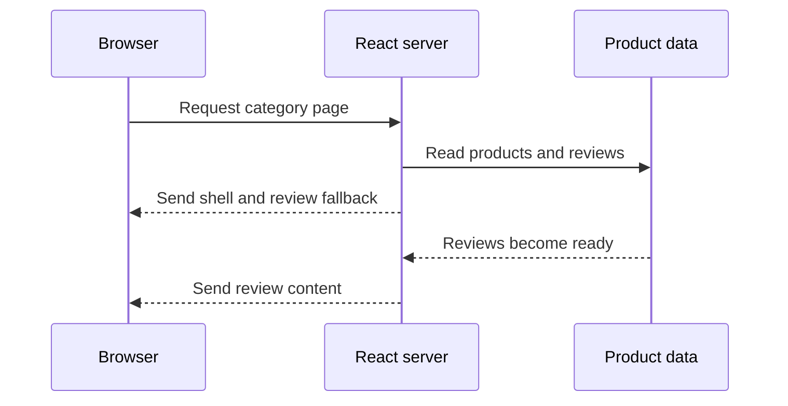

# Hydration, Streaming SSR & Islands — Deep Dive

> **Track:** SD · **Type:** concept · **Scheduled:** Week 5 · **Runtime:** Node v22.14.0 · **Generated:** 2026-11-06

## Why It Exists

Imagine opening a marketplace category page for trail shoes. It has a title, 24 products, filters, and a bag count. If the browser receives only JavaScript, the shopper may wait for code and data before seeing products. If a server sends finished HTML, the products can appear sooner, but filter controls may still be inert until client JavaScript starts. If the server waits for a slow reviews section before sending anything, useful content waits behind it.

The choice is not simply “server or browser.” It is where each part is rendered, when it is sent, which parts need browser behavior, and how fresh the data must be. This lesson follows that one category page throughout.

No direct source about Myntra's or Meesho's rendering implementation was opened for this lesson. The commerce discussion below is illustrative: it explains why a marketplace team would care about these decisions, not what either company currently runs.

### Tiny primers

**HTML and the DOM:** HTML is the document text; the browser parses it into a tree of nodes called the DOM. Existing nodes can be visible before application JavaScript runs.

**React rendering:** React components describe UI from inputs and state. A browser render creates or updates DOM nodes; a server render produces HTML instead. See your Week 6 React rendering/reconciliation notes when you reach them.

**HTTP caching:** A cache keeps a response so it can be reused instead of recomputed or fetched again. Cached data can be old; invalidation or expiry decides when it is refreshed. See your Week 7 HTTP caching notes when you reach them.

## Level 1 — Intuition

*(Idea 1)* Think of a shop preparing its display. It can build the display after a shopper arrives, prepare it before opening, or print a display for each request. The browser, a server, and a build process are different places to prepare the first view. The analogy's small story is in [brief.md](brief.md) → Explain It Like I'm 5.

For the trail-shoe page, the first useful picture might already be there when the browser opens the page. That does not tell us whether the filters work yet. A visible picture and a working control are two different milestones.

```text
server sends HTML       -> browser can show the product list
browser runs JavaScript -> filters and bag controls gain behavior
```

**Recap:** The first view can be prepared in different places and at different times.
Visible HTML does not automatically mean the page is interactive.

**Check yourself (C1):** If product names are visible but a filter click does nothing, what has arrived, and what is missing?

<details>
<summary>Answer</summary>

The HTML arrived and can be displayed. The browser-side behavior for the filter has not yet been attached or run.

</details>

## Level 2 — How It Actually Works

*(Idea 2)* The page can arrive as HTML already containing the trail-shoe title and product cards. When JavaScript runs, React can connect its component logic and event handling to that existing DOM instead of starting from an empty root. React calls this step hydration; the term and precise definition are in [brief.md](brief.md) → Glossary.

*(Idea 3)* React needs the first browser render to agree with the HTML already on screen. For example, if the server prints `price: 499` but the first client render says `price: 599`, React sees different initial content. Use a single shared product snapshot for both initial renders; fetch later changes after startup or render a deliberately stable placeholder. The check below is a toy equality model, not React's hydration algorithm.

```js
const server = ["h1: Sneakers", "button: Add"];
const client = ["h1: Sneakers", "button: Add"];
console.log(server.every((node, index) => node === client[index]));
```

```text
true
```

This output was observed with Node v22.14.0. It demonstrates matching initial descriptions only; it does not create a DOM or run React.

*(Idea 5)* Now suppose product details are ready, but reviews are slow. Streaming SSR lets the server begin sending the page before every region is ready. In React's documented Node API, a `Suspense` boundary can send a fallback first and later send the content that replaces it. The initial region outside those boundaries is the shell.



*(Idea 6)* Receiving the shell earlier can make content appear earlier; it does not prove that filter controls are interactive earlier. The stream can finish before the client bundle downloads, and hydration still takes browser work. This small Node run shows promise callback ordering only; it is not an HTTP streaming implementation.

```js
console.log("shell: product title and skeleton");
Promise.resolve("products: 24 items").then((value) => console.log(value));
console.log("server: response stream continues");
```

```text
shell: product title and skeleton
server: response stream continues
products: 24 items
```

The same order was observed in three Node v22.14.0 runs. A promise microtask is not an HTTP chunk; the example only illustrates that an initial step need not wait for later work.

*(Idea 7)* A product page may mostly be text, images, and ordinary links, with only filters, sort controls, and a bag counter needing client-side behavior. Islands architecture keeps the broader page as HTML and makes selected regions interactive separately. Astro documents client islands as selectively hydrated components and server islands as separately rendered dynamic content. These are related ideas, not the same mechanism: a client island adds browser behavior; a server island separates server rendering.

## The Analogy, Mapped

| In the story | In reality | Idea # |
|---|---|---:|
| Prepare the display after a shopper arrives | Render in response to a request (SSR) | 1 |
| Prepare displays before opening | Generate HTML ahead of requests (SSG) | 1 |
| Let the browser assemble the display | Render UI in the browser (CSR) | 1 |
| Refresh a printed display after it gets old | Regenerate cached output (ISR) | 1, 9 |
| Connect controls to a display already on screen | Attach client behavior to existing HTML (hydration) | 2 |
| Open the shop while a later section is still being prepared | Send a shell and then more HTML (streaming SSR) | 5, 6 |
| Put touchscreens only at selected spots | Make selected regions interactive (islands) | 7, 8 |

**Where the analogy breaks:**

- HTML is parsed into a live DOM; it is not a printed object.
- Hydration requires the initial client output to agree with the server output; a shop employee does not have this constraint.
- A stream may be buffered by a server, proxy, or browser path, so sending chunks does not guarantee each chunk is painted immediately.
- A “touchscreen island” still needs design for data sharing, focus, errors, and loading; the analogy hides that engineering work.

## Level 3 — The Formal Picture

*(Idea 4)* A server-generated view can still require JavaScript download, parse, execution, and hydration before React-managed controls work. That interval can leave a page looking ready while controls are inert. Count or measure the client work rather than treating server HTML as a free performance win.

For scale, use an explicitly illustrative transfer estimate: a `150 KB` JavaScript bundle is about `1,200 kilobits`; at `1.5 Mbps` (`1,500 kilobits/s`), the ideal transfer time is `1,200 ÷ 1,500 = 0.8 seconds`. That is about `800 ms` before parsing and execution, ignoring protocol overhead, contention, compression differences, and latency. It is not a measurement of a Myntra or Meesho page.

*(Idea 8)* Selective interactivity can reduce the client code and hydration work only when the static regions really do not need browser behavior. In this example, filters, sort, and bag state are interactive; ordinary product links work as links. If every one of the 24 cards has a client-side quick-add control, those controls still need behavior. “Islands” does not mean “no JavaScript.”

*(Idea 9)* Freshness is independent of whether HTML is streamed. For a stable category description, a cached or prebuilt response may be fine. For price or availability, stale data can confuse a buyer; the add-to-bag and checkout APIs must validate current business state. ISR is a framework-specific revalidation pattern, not a synonym for streaming: the current Next.js guide describes serving a stale cached page after its revalidation interval while regeneration happens in the background, then serving the updated page. Behavior and support depend on framework, router, runtime, and cache setup.

| Concern | What the documented behavior says | Boundary |
|---|---|---|
| React hydration | The initial client output should match the server HTML; treat mismatches as bugs. | React may report or recover from some mismatches, but does not promise to patch every attribute. |
| React streaming | A shell can be piped when ready; content behind a `Suspense` boundary can follow. | HTML can be visible before the browser JavaScript runs. |
| Astro client islands | Components are static by default; client directives opt selected components into browser JavaScript. | This is Astro's documented model, not a universal framework API. |
| Next.js ISR | A stale response may be served while regeneration runs in the background. | This is the current Next.js guide's behavior; do not generalize its exact API to all frameworks. |

Sources opened for this lesson: [React `hydrateRoot`](https://react.dev/reference/react-dom/client/hydrateRoot), [React `renderToPipeableStream`](https://react.dev/reference/react-dom/server/renderToPipeableStream), [Astro islands architecture](https://docs.astro.build/en/concepts/islands/), [Next.js ISR guide](https://nextjs.org/docs/app/guides/incremental-static-regeneration), and [web.dev: Rendering on the Web](https://web.dev/articles/rendering-on-the-web).

**Recap:** HTML rendering, stream timing, client interactivity, and cache freshness are separate choices.
Measure the browser's remaining work and state the freshness contract for changing data.

**Check yourself (C3):** A reviews fallback arrives early, but the filter cannot be clicked yet. Which two milestones are being confused?

<details>
<summary>Answer</summary>

Progressive HTML arrival and client interactivity. Streaming can reveal HTML before the JavaScript bundle loads and hydrates the filter.

</details>

## Variants & Environment Differences

| Variant or environment | What changes | Since / where |
|---|---|---|
| Browser CSR | JavaScript creates or updates the visible DOM after code and data are available. | Browser; see web.dev rendering guide. |
| Request-time SSR | The server creates HTML for a request; server work can increase time to first byte. | Framework and server dependent. |
| SSG / prerendering | HTML is produced ahead of requests and can be served from a CDN; per-request personalization is not inherent. | Build-time behavior; framework dependent. |
| ISR | A framework can refresh cached generated output after a policy or explicit invalidation. | Next.js behavior is version- and runtime-dependent. |
| React streaming | React offers `renderToPipeableStream` for Node streams and `renderToReadableStream` for Web Streams environments. | React docs; choose the API for the server runtime. |
| React Server Components | Components can run in a separate server/build environment and are not sent as client component code; interactive client components can be composed with them. | React 19 docs; distinct from SSR and hydration. |

React Server Components are mentioned only to disambiguate the terms, not taught here. See your Week 6 React rendering/reconciliation notes when scheduled.

## Compared With What You Know

| Aspect | Hydration | SSR |
|---|---|---|
| What it answers | How browser behavior connects to existing HTML | Where and when initial HTML is produced |
| Can happen without the other? | A page may hydrate HTML produced by a server or build step. | SSR may emit HTML without adding client JavaScript. |
| Common trap | Assuming visible HTML is interactive | Assuming HTML from a server means it is interactive |

Tell them apart: SSR produces the starting HTML; hydration connects client behavior to it.

| Aspect | Streaming SSR | Islands |
|---|---|---|
| Main axis | When HTML sections are sent | Which regions get client behavior |
| Typical mechanism | Send shell/fallback, then ready content | Opt selected widgets into client-side JavaScript |
| Can be combined? | Yes, depending on framework | Yes, but not every framework exposes both patterns the same way |

Tell them apart: streaming is about delivery over time; islands are about the scope of interactivity.

| Aspect | SSG / ISR | Streaming SSR |
|---|---|---|
| Main axis | When output is generated or refreshed | When portions of a response are sent |
| Freshness | Build-time or cache-revalidation policy | Does not itself define a freshness policy |
| Typical use | Stable or cacheable routes | A request whose sections become ready at different times |

Tell them apart: ISR decides when cached output is regenerated; streaming decides how a response is progressively delivered.

| Aspect | React Server Components | Hydration |
|---|---|---|
| Main axis | Where a component executes and whether its implementation is sent to the client | How client React connects to existing server HTML |
| Relationship | Can be part of an architecture whose output is also server-rendered | May still be needed for interactive Client Components |
| Common trap | Treating “server component” as another name for server-rendered HTML | Treating hydration as the rendering location |

Tell them apart: Server Components describe component execution and bundling; hydration describes client takeover of existing HTML.

## Where It's Used

- **Documented:** Astro's islands guide uses an e-commerce storefront to illustrate static main product content alongside dynamic pieces such as a visitor avatar, deals, and reviews. This documents Astro's example, not Myntra or Meesho's architecture.
- **Illustrative:** A marketplace category page can use cached or server-generated product HTML for early content, while filters and sort controls receive client behavior. The choice depends on freshness, personalization, and what the controls actually do.
- **Illustrative:** A product detail page may stream a slower reviews section after the title and core product content, if the framework and data path support it.
- **Illustrative:** A sale landing page with mostly stable copy and links may be prerendered; a personalized bag count may need a separate dynamic path.
- **Illustrative:** Myntra and Meesho are useful examples of the marketplace product context: large catalogs, browsing, and purchase flows make content arrival, interactivity, and freshness important. This is not a claim about their current stacks or measured performance.

## Misconceptions & Traps

No personal misconception or pasted-code issue was reported at intake. These are common topic traps.

**“If the HTML arrived, the page is interactive.”**

*Why it seems right* — The page looks complete, so it is natural to assume its controls are ready.

*Why it is wrong* — The Node-only toy separates markup from handler state; it is not a browser simulation.

```js
const markup = "<button>Add</button>";
const hasClientHandler = false;
console.log(markup);
console.log(hasClientHandler);
```

```text
<button>Add</button>
false
```

This output was observed with Node v22.14.0. The HTML string contains no event listener.

*The correct model* — Server HTML can be visible before client JavaScript runs. Interactivity requires the relevant browser behavior to be loaded and connected.

**“Hydration will fix any server/client difference.”**

*Why it seems right* — Hydration is the client step that connects React to server output, so it can sound like a reconciliation pass that repairs arbitrary markup.

*Why it is wrong* — React's `hydrateRoot` documentation says the initial output should be identical, mismatches are bugs, and attribute differences are not guaranteed to be patched. A real mismatch check needs a browser and React runtime.

```jsx
// Not run — paste into a React app with server-rendered HTML.
hydrateRoot(root, <Product price={599} />);
```

Expected: if the server rendered a different initial price, React may report a hydration mismatch; fix the shared initial data rather than relying on patching. See the opened React `hydrateRoot` documentation linked above.

*The correct model* — Make the server and first client render use the same snapshot. Update changing data after the initial render or use a stable placeholder.

**“Streaming means the page is interactive sooner.”**

*Why it seems right* — The browser can receive and display part of the page earlier.

*Why it is wrong* — In this observed Node scheduling example, the shell log appears before later work, but there is no browser bundle or event handler in the program.

```js
console.log("shell: product title and skeleton");
Promise.resolve("products: 24 items").then((value) => console.log(value));
console.log("server: response stream continues");
```

```text
shell: product title and skeleton
server: response stream continues
products: 24 items
```

Observed in three Node v22.14.0 runs. This demonstrates JavaScript ordering, not HTTP streaming.

*The correct model* — Streaming can improve when HTML becomes available; bundle download, execution, and hydration are separate work.

**“ISR and streaming are two names for progressive output.”**

*Why it seems right* — Both can make a visitor see content before some later work finishes.

*Why it is wrong* — This deterministic cache example changes a stored page from stale to fresh; it says nothing about sending chunks.

```js
const cached = { price: 499, state: "stale" };
console.log(cached.state, cached.price);
cached.price = 459;
cached.state = "fresh";
console.log(cached.state, cached.price);
```

```text
stale 499
fresh 459
```

This output was observed with Node v22.14.0. The Next.js ISR guide describes stale serving and background regeneration as a cache behavior.

*The correct model* — Revalidation controls when cached output is refreshed; streaming controls when parts of a response are sent.

**“Islands make JavaScript free or remove all hydration.”**

*Why it seems right* — A mostly static page can avoid sending a full client application.

*Why it is wrong* — Astro's documentation says selected client islands still load browser JavaScript; every interactive region still has behavior and coordination costs.

*The correct model* — Islands can limit client code to selected regions. If all 24 product cards need client-side controls, those regions still need their code and startup work.

**“Server Components are just SSR, so they remove hydration.”**

*Why it seems right* — Both terms include “server,” and both can contribute to HTML seen by the browser.

*Why it is wrong* — React's Server Components documentation distinguishes server component execution from optional SSR output; interactive Client Components may still need client JavaScript and hydration.

*The correct model* — Ask separately where a component executes, what HTML is sent, and which browser components need client behavior. This lesson names the distinction but leaves Server Components as an adjacent topic.

## Limits & Trade-offs

*(Idea 10)* A marketplace team should choose per route and region, not declare one rendering mode “best.” For the 24-item category example, a reasonable interview answer is: get useful product HTML to the browser early, keep ordinary links native, give filters and sort the necessary browser behavior, stream only an independently slow section if the framework supports it, and state how price/availability freshness is protected. The exact design is illustrative, not a Myntra or Meesho implementation claim.

| Cost or limit | When it bites |
|---|---|
| Extra JavaScript transfer and execution | Low-end devices or slow networks; illustrative `150 KB` at `1.5 Mbps` takes about `800 ms` to transfer before parsing, under idealized assumptions. |
| Hydration work | A large interactive tree needs more client startup work; count the interactive regions and profile actual devices. |
| Request-time rendering | Server data access and rendering can increase time to first byte or compute load. |
| Cached output | Product copy, price, or availability can be stale unless freshness and invalidation are designed. |
| Islands | Cross-island state, shared bundles, and interaction boundaries add design complexity. |
| Streaming | A useful shell and error/status strategy are needed; after response bytes are sent, some response metadata can no longer be changed. |

SSR is useful when request-specific HTML matters, but it does not guarantee fast interactivity. Static output and islands can reduce per-request or client work, but only when freshness and behavior requirements allow it. Measure the actual bottleneck and make the tradeoff explicit.

## Interview Notes

The question may be phrased as “Explain hydration,” “How does streaming SSR help?” or “Which rendering strategy would you use for a product listing?” Begin with the visible-HTML-versus-working-controls distinction, then separate render location, delivery timing, interactivity scope, and freshness.

Likely follow-ups: how to avoid hydration mismatches (same initial snapshot); whether streaming guarantees interactivity (no); what happens to price and stock (define freshness and validate on purchase); and why not hydrate every component (client work may be wasted for static regions). At this level, defend one route-specific tradeoff rather than claim one strategy wins everywhere.

In under two minutes: “For a 24-item listing, the server or build can provide product HTML so content is visible early. Hydration is a separate client step and the first client output must match. Streaming can reveal an early shell before a slower section is ready, but does not make controls interactive by itself. Islands limit browser JavaScript to regions that need it. I would choose caching or request-time rendering based on personalization and freshness, then measure client startup and server response. I am not claiming Myntra or Meesho use a particular stack.”