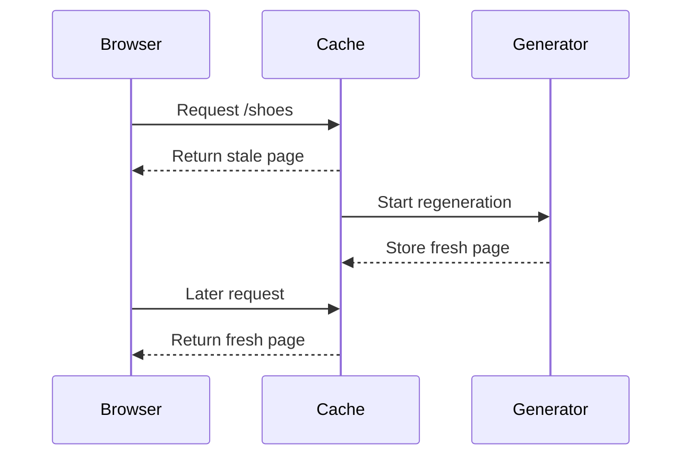

# Rendering Strategies — Deep Dive

> **Track:** SD · **Type:** concept · **Scheduled:** Week 5 · **Runtime:** Node v22.14.0 · **Generated:** 2026-11-05

## Why It Exists

The same product-category page can show stock from the moment its HTML arrives, or only after browser JavaScript and a data request finish. A build-time page can still say “12 left” after inventory has fallen to 11. The choice is not just “fast or slow”: it decides when data is read, where HTML is made, and which work the browser and server must do.

This small Node program models the four paths for one route. It is an illustrative model, not a framework runtime. Every line of output below was observed with Node v22.14.0.

```js
const render = (stock) => `<li>Trail shoes: ${stock} left</li>`;
const currentStock = 11;
const cachedHtml = render(12);
console.log("CSR shell:", '<div id="app"></div>');
console.log("CSR after fetch:", render(currentStock));
console.log("SSR request:", render(currentStock));
console.log("SSG build:", cachedHtml);
console.log("SSG later:", cachedHtml);
console.log("ISR stale:", cachedHtml);
console.log("ISR refreshed:", render(currentStock));
```

```text
CSR shell: <div id="app"></div>
CSR after fetch: <li>Trail shoes: 11 left</li>
SSR request: <li>Trail shoes: 11 left</li>
SSG build: <li>Trail shoes: 12 left</li>
SSG later: <li>Trail shoes: 12 left</li>
ISR stale: <li>Trail shoes: 12 left</li>
ISR refreshed: <li>Trail shoes: 11 left</li>
```

The program makes the data difference visible; the real browser and framework add network, caching, and rendering work that this toy program does not simulate.

## Level 1 — Intuition

Use the shop story in the Brief’s “Explain It Like I’m 5” section. For the same `/shoes` page, the important question is where the list is put together: in the browser, for each request at the server, or ahead of time and kept ready.

*(Idea 1)* A rendering strategy is a choice about **where and when** the page’s HTML is produced. It is not a promise that one page will be fastest on every device or network.

```text
product data
  ├── browser builds page after loading JavaScript (CSR)
  ├── server builds page for a request (SSR)
  └── build creates saved HTML (SSG)
         └── supported systems can refresh saved HTML later (ISR)
```

The saved HTML paths trade freshness for less repeated generation. The browser-built path moves more work and a data wait to the visitor’s device.

**Recap:** The choice is about where and when HTML is made.
A page can combine paths; the name is not an all-or-nothing property of a whole product.

**Check yourself (C1):** If the stock number changes after a page was generated, which paths can still show the old number?

<details>
<summary>Answer and why</summary>

A saved build-time page can show the old number until it is rebuilt or refreshed. A server-rendered request can read current data, while a browser-rendered page can show the new number after its data request completes. An incremental refresh can serve an old saved page before a later request receives the regenerated one.

</details>

## Level 2 — How It Actually Works

A browser may receive an almost-empty root element first and fill it after JavaScript runs. That is **client-side rendering (CSR)**. *(Idea 2)* The server may instead turn the current data into HTML for each request; that is **server-side rendering (SSR)**. *(Idea 3)* Both can appear in the same app; the names describe how a particular page or region starts.

A build can turn public data into HTML before visitors arrive. That is **static site generation (SSG)**. *(Idea 4)* A supported framework can keep generated output and refresh it over time or after an invalidation; that is **incremental static regeneration (ISR)**. *(Idea 5)* The timing and stale-response rules depend on the framework and its configuration, so “ISR” is not a browser or ECMAScript feature.

The canonical program above observes these stages. The output is the evidence; this trace explains it:

```text
step  event                       page data       what the visitor can receive
1     build calls render(12)      12 left         saved HTML is made
2     stock changes to 11         11 left         saved HTML is unchanged
3     CSR document arrives        not in HTML     browser has an empty root
4     CSR fetch completes         11 left         browser builds the list
5     SSR request renders         11 left         response contains current list
6     SSG request uses snapshot   12 left         response still contains old list
7     ISR serves stale snapshot   12 left         old generated list is usable
8     ISR refresh completes       11 left         later response can use new list
```

The trace is a simplified model, not observed framework behavior. For example, the current Next.js guide describes a time-based ISR request serving stale output while regeneration happens in the background, then serving the updated output on later requests. See [Next.js: Incremental Static Regeneration](https://nextjs.org/docs/app/guides/incremental-static-regeneration).

When a visitor sees HTML first and the browser later connects the app’s event logic and state to it, that second step is **hydration**. *(Idea 6)* It can let content be present before all client JavaScript is ready, but it does not make the JavaScript download or execution free. React’s current `hydrateRoot` documentation expects the client’s initial output to match the server HTML and says frameworks may call the API for you; see [React: `hydrateRoot`](https://react.dev/reference/react-dom/client/hydrateRoot).

*(Idea 7)* **Content being visible and controls being interactive are separate milestones.** A server response can contain a “Buy” button before its client behavior is ready. If the JavaScript is slow, the visitor may see the control but be unable to use it yet. Conversely, a CSR page can be interactive once its client code and data are ready, but the initial content waits on those steps.

**Recap:** CSR makes the initial page in the browser; SSR makes it for a request; SSG makes it at build time; ISR refreshes generated output according to framework rules.
HTML being present does not prove that client behavior is ready.

**Check yourself (C2):** In the canonical output, why does the later SSG line still say 12, while the SSR line says 11?

<details>
<summary>Answer and why</summary>

SSG reuses the saved string made while stock was 12. The toy SSR call invokes `render` with the current value, 11, for that request. The distinction is when the data is read, not whether the output happens to be HTML in both cases.

</details>

## The Analogy, Mapped

| In the shop story | In reality | Idea # |
| --- | --- | --- |
| Browser assembles the list after opening the box | JavaScript creates the page in the browser | 2 |
| Staff assembles a list for each visitor | The server creates HTML for each request | 3 |
| Lists are prepared before opening | A build creates HTML ahead of requests | 4 |
| A prepared list is replaced after a refresh | A framework regenerates cached output | 5 |
| The buttons get connected to working controls | Client code hydrates existing HTML | 6 |

**Where the analogy breaks:**

- A browser does not literally assemble products; it parses HTML, applies styles, runs JavaScript, and paints pixels.
- A shop’s “refresh” is not a precise model of a framework cache. Expiration, invalidation, failures, and cache sharing are implementation-specific.
- Preparing content early does not automatically make delivery fast; network, HTML size, CSS, and JavaScript still affect the user’s experience.

## Level 3 — The Formal Picture

*(Idea 8)* Choose from page requirements, not from a blanket rule like “SSR is best for SEO.” For the shoe category, ask whether the HTML must contain current stock on every request, whether a short stale window is acceptable, and whether the content is public. Then choose the least expensive path that still meets those needs.

| Page condition | Candidate | What it buys | What it costs or risks |
| --- | --- | --- | --- |
| Public content changes rarely | SSG | Reuse generated HTML; little per-visit page generation | Data remains at build snapshot until refreshed |
| Public content may be briefly stale | ISR | Reuse HTML and refresh it without rebuilding every route | Staleness, invalidation, cache coordination, and regeneration work |
| Output must use request-specific data | SSR | The server can read request context and produce HTML for that request | Per-request compute and dependence on the server/data path |
| Page is highly client-driven or private data is isolated | CSR, often for a region | Client-owned interaction and personalization | JavaScript and data wait; work and failure move to the browser |

*(Idea 9)* A **cache** stores a previous result so later requests can reuse it. Caching is not a fifth rendering strategy: a server-rendered response may be cached, and generated HTML still has to be delivered. A cache’s key, freshness window, invalidation path, and failure behavior decide whether reuse is safe. The current [Next.js caching guide](https://nextjs.org/docs/app/guides/caching) documents separate data and route-cache controls; those details are framework-specific.

*(Idea 10)* A product can mix approaches. A public category shell can be generated and cached, while a member-only recommendation region loads for that member. A sale price that must be checked at request time can use a separate request-time API even if the surrounding page is static. Do not use the page label to imply every byte came from one place.



The sequence is the documented time-based behavior in the cited Next.js ISR guide, not a guarantee for every platform called “ISR.” A failed regeneration can leave the last successful output in service in Next.js; the same guide describes retrying on a later request.

**Recap:** Match freshness and personalization needs to where data is read.
Treat rendering, client interactivity, and cache policy as related but distinct choices.

**Check yourself (C3):** A public shoe page may be one minute stale, but a member’s recommendations must be private. What would you render together, and what would you keep separate?

<details>
<summary>Answer and why</summary>

Generate or cache the public category content using a path that tolerates the stated stale window, and keep the member-specific data in a separately authorized region or request. This avoids making every visitor’s public HTML depend on member data while preserving the privacy boundary. The exact server/client split depends on the framework and security design.

</details>

## Variants & Environment Differences

| Variant or environment | What changes | Since / where |
| --- | --- | --- |
| Plain CSR page | The initial HTML may be a shell; JavaScript fills in content. CSR can coexist with server HTML elsewhere on the page. | MDN’s [CSR glossary](https://developer.mozilla.org/en-US/docs/Glossary/CSR) |
| React hydration | React attaches to existing server-generated DOM; initial client output should match the HTML. Frameworks commonly manage the call. | Current React [`hydrateRoot`](https://react.dev/reference/react-dom/client/hydrateRoot) reference |
| Next.js ISR | Cache and regeneration behavior depends on router, configuration, and cache mode. Current guides separate ISR with and without Cache Components; Cache Components were introduced in Next.js 16 behind a flag. | Next.js [ISR guide](https://nextjs.org/docs/app/guides/incremental-static-regeneration) |
| Next.js static export | The cited Next.js ISR guide lists static export as unsupported for ISR. | Next.js [ISR guide](https://nextjs.org/docs/app/guides/incremental-static-regeneration) |
| Node snippet vs browser | The snippets here create strings and model decisions. They do not execute a DOM, load CSS, hydrate React, or measure paint. | This document’s Node v22.14.0 verification |

The core CSR/SSR distinction is about where HTML is generated, not whether the app uses a single-page navigation model. MDN notes that single-page apps do not have to use CSR and that the techniques can be combined.

## Compared With What You Know

There is no evidence from the intake that you have used these neighboring topics yet; the requested primers are kept short in this lesson.

### Prerequisite primers

**HTTP request/response basics.** A browser sends a request; a server replies with a status, headers, and a body such as HTML or JSON. CSR commonly fetches page data after the document arrives; SSR can fetch data before returning HTML.

**Browser rendering pipeline / CRP.** After content arrives, the browser parses HTML and CSS and runs JavaScript to produce the displayed page. Blocking resources and later layout or paint work can delay what the visitor sees, regardless of which strategy produced the HTML.

**React rendering and hydration.** React components describe UI from inputs such as props and state; React applies updates to the DOM. When server HTML already exists, React can attach its client behavior to matching initial output.

**HTTP caching.** A browser or CDN can reuse a response according to its cache policy. Freshness and invalidation govern reuse; they do not decide where the HTML was originally generated.

| Aspect | Browser rendering pipeline | Rendering strategy |
| --- | --- | --- |
| Question | What does the browser do with delivered HTML, CSS, and JavaScript? | Where and when is the page HTML produced? |
| Boundary | Starts with browser processing and ends in a displayed result | Starts with a decision about generating or reusing the response |
| Example | Parsing, style calculation, layout, and paint | CSR, SSR, SSG, or ISR for `/shoes` |

Tell them apart: if the question is how received content becomes pixels, it is the browser pipeline; if it is where the initial page content is made, it is a rendering strategy.

| Aspect | HTTP caching | Rendering strategy |
| --- | --- | --- |
| Question | Can a response or data result be reused, and for how long? | Where and when is the HTML produced? |
| Can it combine? | Yes; caching can apply to server output or data | Yes; any strategy may have a cache, subject to its implementation |
| Trap | A fresh cached response can still contain stale source data | SSR does not imply “uncached,” and SSG is not the only cacheable output |

Tell them apart: if the decision is reuse and freshness, it is caching; if it is where HTML is produced, it is rendering strategy.

| Aspect | Hydration | Rendering strategy |
| --- | --- | --- |
| Question | How does client code connect to already-present server HTML? | How was that HTML initially produced? |
| Result | Existing controls gain client behavior when the app is ready | The page’s initial HTML comes from a browser, request, or build path |
| Trap | Hydration is not required for every server-rendered page | SSR can return useful HTML even if no React hydration follows |

Tell them apart: hydration describes a client follow-up to existing HTML; it does not name the source or generation time of that HTML.

| Aspect | Single-page app navigation | Rendering strategy |
| --- | --- | --- |
| Question | How does navigation between views work? | How is initial HTML produced? |
| Relationship | Client-side navigation can follow an SSR or SSG initial response | CSR can be used without adopting every SPA convention |
| Trap | “SPA” does not mean “all HTML is created by CSR” | An initial server response does not force full-page navigation |

Tell them apart: SPA describes a navigation/application pattern; CSR describes where HTML is generated.

## Where It's Used

- **Illustrative:** A filter-heavy internal product catalog can render the stable shell first and let the browser update filters without requesting a new document each time. This favors interaction locality, but not necessarily a CSR-only initial load.
- **Illustrative:** A public category page with request-sensitive stock can render its initial HTML on the server. This avoids waiting for a separate browser data request before the first product list, but adds work to the request path.
- **Illustrative:** A campaign landing page that changes only when marketing publishes can use generated HTML. The build snapshot is simple to reuse, but a publish must trigger a rebuild or another refresh path.
- **Documented:** Next.js describes ISR as updating generated content without rebuilding the entire site, including time-based and on-demand revalidation paths. See its [ISR guide](https://nextjs.org/docs/app/guides/incremental-static-regeneration).
- **Documented:** React’s `hydrateRoot` connects React to HTML previously generated in a server environment; the React reference notes that a framework may perform this step. See [React: `hydrateRoot`](https://react.dev/reference/react-dom/client/hydrateRoot).

No code or product example from your own work was shared in the intake.

## Misconceptions & Traps

### The HTML from SSR is automatically interactive

*Why it seems right:* The button is already visible, so it looks finished.

*Why it is wrong:* HTML can contain a button without containing a browser event handler. This toy check was run with Node v22.14.0:

```js
// WRONG — assumes an HTML button string contains its browser event handler.
const buttonHtml = "<button>Buy</button>";
console.log(buttonHtml);
console.log(buttonHtml.includes("onclick"));
```

```text
<button>Buy</button>
false
```

*The correct model:* Server HTML can provide content before client JavaScript is ready. A framework may hydrate the page to connect behavior; until then, visibility and interactivity are different milestones.

### The server and client can start from different markup during hydration

*Why it seems right:* The browser might have extra information that the server does not.

*Why it is wrong:* React’s current hydration reference says the initial client output should match the server HTML. This string comparison was run with Node v22.14.0:

```js
// WRONG — assumes hydration can safely start from different initial markup.
const server = "<button>Buy</button>";
const client = "<button>Checkout</button>";
console.log(server === client);
```

```text
false
```

*The correct model:* Make the initial output match, then update after hydration when client-only information is available. React warns that mismatches are bugs and does not guarantee every mismatch will be patched.

### A generated page reads the latest stock whenever it is requested

*Why it seems right:* Each visitor makes a new HTTP request.

*Why it is wrong:* A build snapshot is a saved string. Changing the source variable does not rewrite it. This was run with Node v22.14.0:

```js
// WRONG — expects a build snapshot to read live inventory on every request.
let stock = 12;
const snapshot = `<p>${stock} left</p>`;
stock = 11;
console.log(snapshot);
```

```text
<p>12 left</p>
```

*The correct model:* The page needs a rebuild, regeneration, or a separately fetched live value. ISR is one framework-specific way to refresh generated output; it does not make every snapshot live by itself.

### CSR means every part of the page must be client-rendered

*Why it seems right:* CSR is often discussed as the opposite of SSR.

*Why it is wrong:* A page can contain server-produced public content and a client-managed region. MDN explicitly notes the techniques are not mutually exclusive. This illustrative composition was run with Node v22.14.0:

```js
// WRONG — assumes a public route cannot mix server HTML and client-only content.
const page = "<main><h1>Trail shoes</h1><div id=\"member-picks\"></div></main>";
console.log(page);
```

```text
<main><h1>Trail shoes</h1><div id="member-picks"></div></main>
```

*The correct model:* Choose where each region gets its data and behavior. Keep the public shell, private member data, and freshness needs explicit; the framework may let them use different paths.

### ISR refreshes automatically when the clock expires

*Why it seems right:* The setting is often expressed as a time interval, so it sounds like a repeating timer.

*Why it is wrong:* In the documented Next.js time-based flow, expiry makes cached output eligible for revalidation; a later request can receive stale output while regeneration begins. This deliberately wrong timer model was run with Node v22.14.0:

```js
// WRONG — treats expiry itself as a regeneration request.
let refreshes = 0;
const onClock = (ageSeconds) => {
  if (ageSeconds >= 60) refreshes++;
};
onClock(60);
console.log("refreshes at expiry:", refreshes);
```

```text
refreshes at expiry: 1
```

*The correct model:* Do not assume the framework runs a periodic rebuild merely because the threshold elapsed. Check its documented trigger, stale-response behavior, cache scope, and failure handling; those details are not part of a general web standard.

## Limits & Trade-offs

The toy data trace does not measure paint, network delay, JavaScript execution, or server CPU. Here is a derived request-count example, not a benchmark: if 10,000 visits each trigger one uncached CSR product-data request, that is `10,000 × 1 = 10,000` extra data requests/day, or `10,000 ÷ 86,400 ≈ 0.116` requests/second averaged across the day. Peaks can be much higher; caching and client-side reuse change the count.

A second illustrative calculation: if the CSR path needs a 180 KB compressed JavaScript bundle and the connection sustains 1.5 Mbps, transfer time alone is `180 KB × 8 ÷ 1,500 kb/s = 0.96 s`, before connection overhead, parsing, execution, or the data request. Those inputs are assumptions, not measurements of your app.

| What it costs | When it bites |
| --- | --- |
| More JavaScript transfer and execution | CSR-heavy initial views on slow networks or low-end devices |
| Per-request data/render work | SSR routes with high traffic, expensive queries, or a slow upstream service |
| Stale content and invalidation work | SSG/ISR pages with prices, inventory, or legal copy that must be current |
| Cache coordination and failure handling | ISR across multiple server instances or regions; the cache must be shared or invalidated consistently |
| Extra wait for client behavior | Server HTML is visible but hydration code is delayed or fails |

No strategy guarantees the best Largest Contentful Paint (LCP) or search visibility by its name alone. Measure the rendered page, its data path, and its interaction readiness on the target devices. For this topic, a small hybrid is often the right comparison point: generated public content, a narrowly scoped live-data path, and request-time rendering only where freshness or personalization requires it.

## Interview Notes

A useful opening is: “I’d choose per route based on freshness, personalization, and what must be in the first HTML. CSR, SSR, SSG, and ISR move the work to different times and places, and I would combine them when regions have different needs.”

Be ready to defend three distinctions: build-time snapshot versus request-time output; visible HTML versus hydrated interaction; rendering versus caching. If asked about performance, explain the path and name what you would measure rather than saying one strategy is always faster. For this Week 5 `SD` slot, connect the answer to the Week 10 product listing page and Week 11 image-heavy feed, then leave full browser-pipeline and caching design to their scheduled topics.
